# PC 上复刻 CanMV / MicroPython 的 LVGL 桌面启动器

把 `D:\zishen\Desktop\CanMV Sample\main.py`（3547 行 MicroPython，K230 + 640x480 屏）里的
`GUI` 那一套界面，用 **C + LVGL 8.3.3** 重新实现，跑在 `lv_port_pc_eclipse` 这个 PC 模拟器上。

> 除了本目录（`myCode/`）之外，只改动 4 个原有文件，改动内容见文末「改了哪些原有文件」。
> 目标是**可读、可改、可对照**，不是逐行逐像素搬运。

---

## 1. 效果

| 锁屏（大时钟 + 呼吸提示） | 上滑解锁 |
|---|---|
| 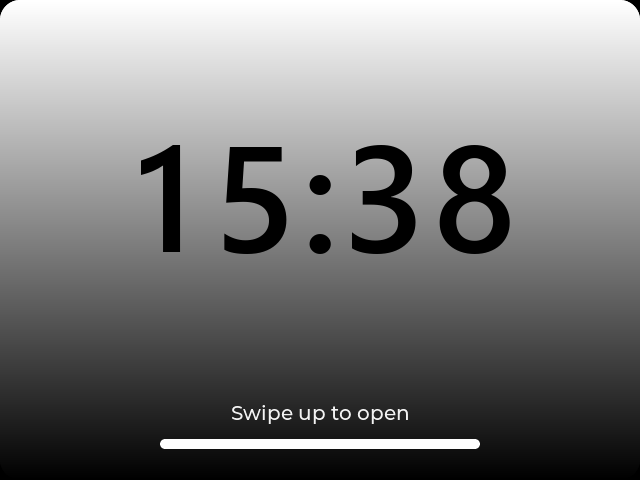 | 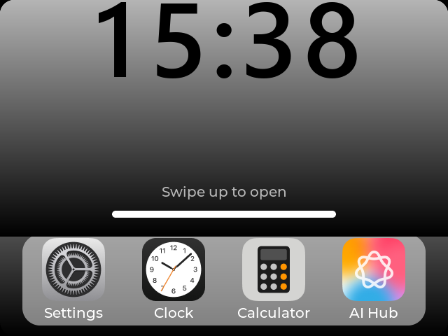 |

| 主屏第 0 页 | 主屏第 1 页（左右拖动翻页） |
|---|---|
| 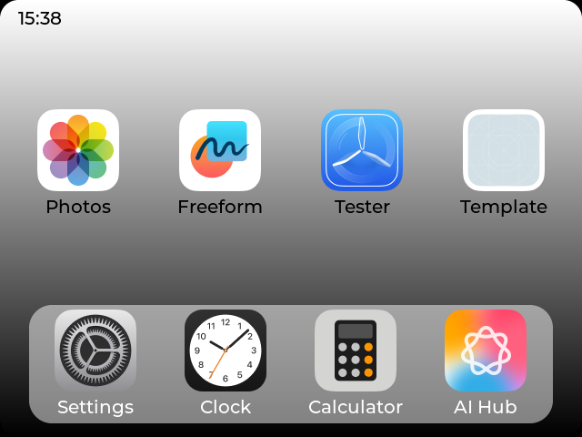 | 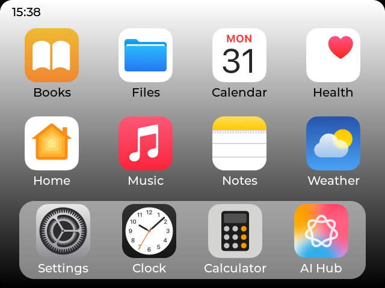 |

| 点图标 → App 从图标里"长"出来 | Clock App |
|---|---|
| 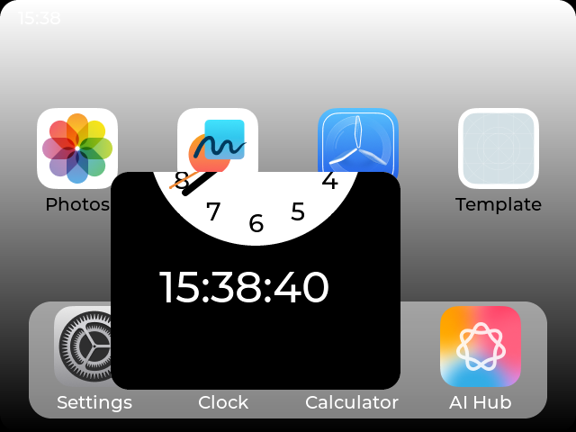 | 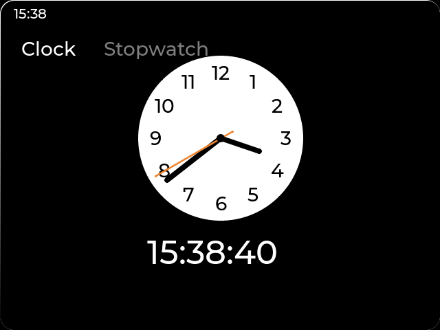 |

| 上滑 → App 缩小回图标 | AI Hub 里点 Run 弹出的说明框 |
|---|---|
| 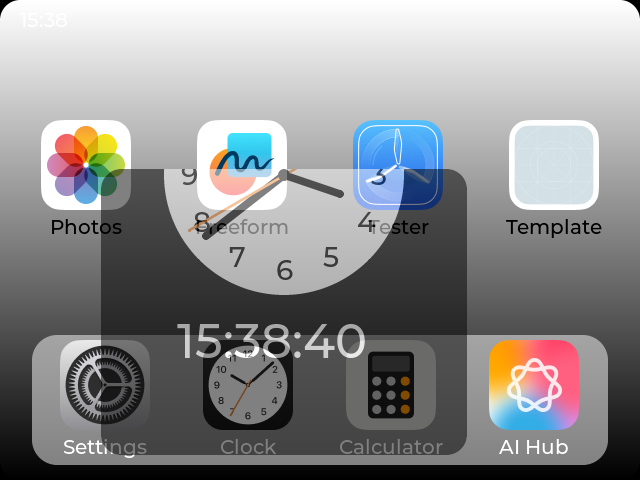 | 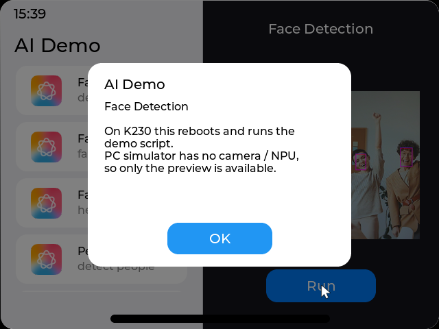 |

### 里面装好的 20 个 App（主屏 + Dock 每一个图标都能点进去）

| Calculator（能算：12+3=15） | Photos（上下滑动翻页，点击切全屏） |
|---|---|
| 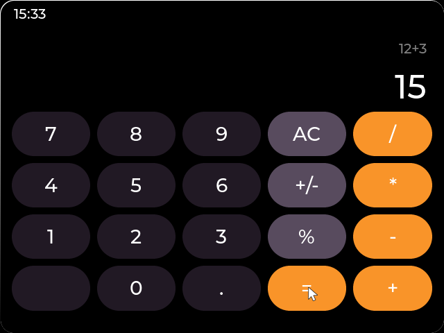 | 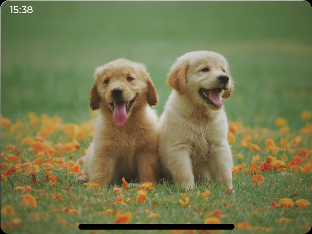 |

| Settings（改日期时间，整个界面跟着变） | Freeform（画板，点左边缘手柄调笔色/粗细） |
|---|---|
| 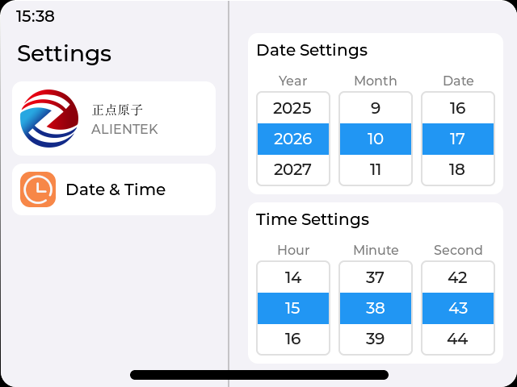 | 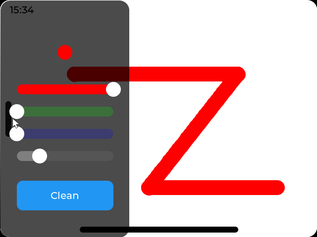 |

| Tester（4 个竖条拖动，图标发光） | AI Hub（19 个例程列表 + 截图预览） |
|---|---|
| 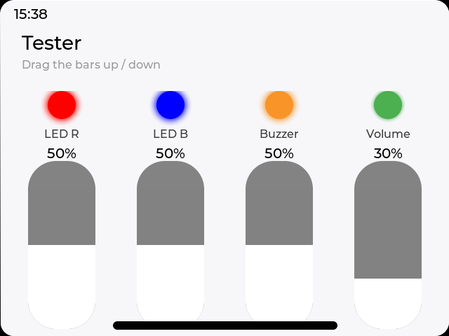 | 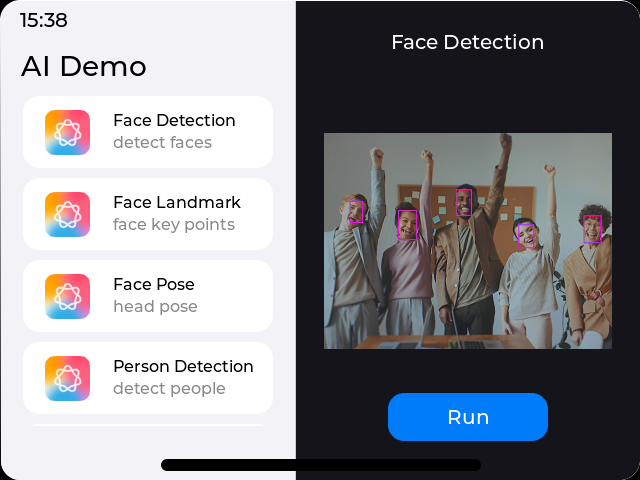 |

| Calendar | Weather |
|---|---|
| 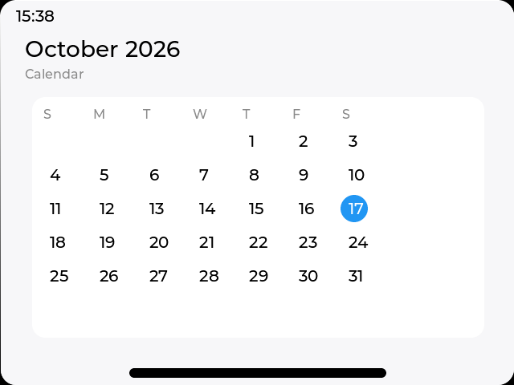 | 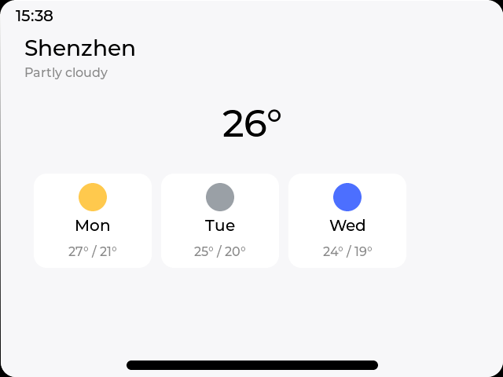 |

| Music | Home（智能家居开关） |
|---|---|
| 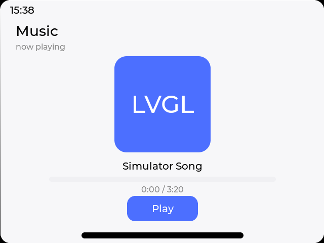 | 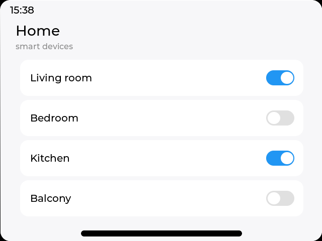 |

Books / Files / Health / Notes / Template 的截图也在 `docs/screenshots/` 里。

---

## 2. 编译运行

工具链：MSYS2 **UCRT64** 自带的 `cmake` / `mingw32-make` / `gcc` / `SDL2`。

```powershell
$env:PATH = "D:\software\msys64\ucrt64\bin;$env:PATH"
cd D:\zishen\Desktop\lv_port_pc_eclipse

# 注意：要显式指定 -G "MinGW Makefiles"，否则本机的 cmake 会默认选 Ninja，
# 生成的目录里没有 Makefile，后面的 mingw32-make 就找不到目标了。
cmake -S . -B build -G "MinGW Makefiles" -DCMAKE_BUILD_TYPE=Release
mingw32-make -C build -j8
.\bin\main.exe
```

（如果你更想用 Ninja，就把后两行换成 `ninja -C build`。）

Eclipse 用户照旧用 `.project` / `pc_simulator.launch`，重新 build 一次即可。

### 鼠标操作

| 操作 | 效果 |
|---|---|
| 在屏幕**底部**按住往上拖，松手时拖过屏幕 1/3 | 解锁 |
| 主屏图标区**左右拖** | 翻页（自动吸附到整页） |
| 点图标 | 按下时放大到 105%，松手弹回，然后打开 App |
| 在 App 里从**屏幕最底边**往上拖（底部 40px 那条带） | 边拖边缩小，拖过 3/4 屏就缩回图标并关闭；否则弹回全屏 |
| 键盘 `L` | 重新锁屏 |
| 键盘 `Esc` | 关闭当前 App / 关闭提示框 |

### 资源路径

资源的根目录就是 **`myCode/` 本身**（编译时由 CMake 把绝对路径写进 `MYGUI_ASSET_DIR`），
所以代码里的路径写法和 CanMV 完全一样：

```c
assets_png("APP/icons/app_icon_90x90_clock.png")   /* ↔ CanMV: RESOURCES_PATH + "APP/icons/..." */
assets_png("Fonts/clock_digit_0.png")              /* ↔ CanMV: RESOURCES_PATH + "Fonts/..."       */
```

换目录可以用环境变量覆盖：

```powershell
$env:MYGUI_ASSETS = "D:\some\other\myCode"
```

---

## 3. 目录结构（照着 CanMV Sample 分的）

```
CanMV Sample/                      myCode/
├── main.py                  ↔    ├── launcher.c/.h        入口：屏幕骨架、时钟、快捷键、自检脚本
├── APP/                     ↔    ├── APP/                 每一个 App 一个文件夹
│   ├── icons/               ↔    │   ├── icons/           App 图标（16 张 90x90 PNG）
│   ├── AI Hub/*.py          ↔    │   ├── AIHub/           aihub_app.c/.h    例程列表 + 预览
│   ├── Settings/*.py        ↔    │   ├── Settings/        settings_app.c/.h 左栏 + 日期时间滚轮
│   └── Tester/*.py          ↔    │   ├── Tester/          tester_app.c/.h   4 个竖条控制
├── Fonts/*.bin              ↔    ├── Fonts/                大时钟数字位图（clock_digit_*.png）
└── Photos/*.png             ↔    └── Photos/               相册素材（7 张，从 CanMV Sample 复制）
```

再加上 `main.py` 里那些不属于"资源/App"的东西，本目录对应拆成了：

```
myCode/
├── launcher.c / launcher.h          ↔ main.py 的 main() + GUI.__init__()
├── Common/                          ↔ 平台/基础设施（CanMV 里这层在 MicroPython 绑定里）
│   ├── theme.h                      所有尺寸、颜色、字体常量
│   ├── assets.c/.h                  PNG 读盘 + 缓存，产出 lv_img_dsc_t
│   ├── clock_model.c/.h             "可以调的时钟"（真实时间 + 偏移），顶替硬件 RTC
│   └── snapshot.c/.h                开发自检：整屏截图存 BMP（第 7 节）
├── GUI/                             ↔ main.py 里的 class GUI.*
│   ├── lock_screen.c/.h             GUI.LockScreen
│   ├── home_screen.c/.h             GUI.HomeScreen（背景 / 图标网格 / Dock / 应用表）
│   ├── status_bar.c/.h              GUI.HomeScreen.StatusBar
│   ├── app_manager.c/.h             GUI.HomeScreen.AppManager / AppLoader / AppBase
│   ├── widgets.c/.h                 通用小工具（渐变容器 / 圆角条 / 标签 / PNG 图）
│   ├── big_clock.c/.h               锁屏大号数字时钟
│   └── msg_box.c/.h                 FullScreenMSG（"还没实现"提示框）
├── APP/                             ↔ CanMV Sample/APP/（一个 App 一个文件夹）
│   ├── icons/                       Dock / 主屏用的 90x90 图标
│   ├── AIHub/                       aihub_app.c/.h + 20 张例程截图
│   ├── Calculator/                  calculator_app.c/.h
│   ├── Clock/                       clock_app.c/.h（Clock + Stopwatch 两页）
│   ├── Extras/                      extras_app.c/.h（原版没实现的 8 个入口，见 5.10）
│   ├── Freeform/                    freeform_app.c/.h（lv_canvas 画板）
│   ├── Photos/                      photos_app.c/.h（上下滑动翻页）
│   ├── Settings/                    settings_app.c/.h + 2 张图标
│   ├── Template/                    template_app.c/.h
│   └── Tester/                      tester_app.c/.h
├── Fonts/                           ↔ CanMV Sample/Fonts/
├── Photos/                          ↔ CanMV Sample/Photos/
├── tools/gen_clock_digits.py        生成 Fonts/ 里那 11 张数字位图
└── docs/screenshots/                第 1 节那些截图
```

**一句话记法**：`GUI/` 是"外壳和框架"（锁屏、主屏、状态栏、App 开关动画），
`APP/` 是"装进去的东西"（每个 App 一个文件夹，和 CanMV Sample 一样），
`Common/` 是"底层设施"（资源、主题、时钟、截图）。

界面层次（和原 `main.py` 一致）：

```
lv_scr_act()                        黑窗口
└── screen                          满屏容器，圆角 20 + 裁剪，模拟设备屏幕
    ├── home_screen.root            上白下黑渐变
    │   ├── app_conv                图标区（可横向滑动，2 页）
    │   └── dock                    底部 Dock
    ├── status_bar                  状态栏
    ├── app_manager.masker          App 缩放容器（打开时 move_foreground 盖住一切）
    └── lock_screen.conv            锁屏（最上层，解锁时向上滑出 -520）
```

---

## 4. MicroPython → C 对照

| MicroPython（`main.py`） | 本目录的 C 写法 | 备注 |
|---|---|---|
| `lv.obj(parent)` / `lv.label(parent)` | `lv_obj_create()` / `lv_label_create()` | |
| `obj.set_size(lv.pct(50), 12)` | `lv_obj_set_size(obj, lv_pct(50), 12)` | |
| `obj.set_style_pad_all(0, 0)` | `lv_obj_set_style_pad_all(obj, 0, 0)` | 第二个参数是选择器（`0` = MAIN/DEFAULT） |
| `obj.clear_flag(lv.obj.FLAG.SCROLLABLE)` | `lv_obj_clear_flag(obj, LV_OBJ_FLAG_SCROLLABLE)` | 原代码几乎每个容器都清一次 |
| `obj.add_event(cb, lv.EVENT.ALL, None)` | `lv_obj_add_event_cb(obj, cb, LV_EVENT_ALL, ud)` | 一个 cb 可以注册多个事件码 |
| `event.get_code()` / `event.get_target()` | `lv_event_get_code(e)` / `lv_event_get_target(e)` | |
| `lv.indev_get_act()` + `indev.get_point(p)` | `lv_indev_get_point(lv_indev_get_act(), &p)` | |
| `a = lv.anim_t(); a.init(); ...; lv.anim_t.start(a)` | `lv_anim_t a; lv_anim_init(&a); … ; lv_anim_start(&a)` | |
| `a.set_custom_exec_cb(lambda anim, v: obj.set_y(v))` | `lv_anim_set_exec_cb(&a, my_cb)`，`my_cb(void *var, int32_t v)` | C 没有 lambda，写几个只做一行的回调（见 `GUI/app_manager.c` 的 `anim_set_x/y/w/h`） |
| `lv.timer_create(cb, 1000, None)` | `lv_timer_create(cb, 1000, ud)`，cb 收 `lv_timer_t *` | 单次定时器：`lv_timer_set_repeat_count(t, 1)` |
| `lv.font_load("A:" + RESOURCES_PATH + "Fonts/...bpp4.bin")` | **C 版 LVGL 8 没有运行时字库加载** | 改用内置 Montserrat 字号；只有 150px 大时钟另想办法（见 5.1） |
| `dsc = lv.img_dsc_t({'data_size':…, 'data':…}); img.set_src(dsc)` | 同样思路，但 **必须自己填 `header.w/h`** | 见「坑 1」 |
| `open(path,'rb').read()` | `fopen/fread` + `lv_mem_alloc` | `Common/assets.c` |

---

## 5. 每个动效是怎么做出来的

### 5.1 锁屏大时钟：为什么用图片而不是字体

原代码用 `lv.font_load()` 在运行时加载 150px 的 `.bin` 字库，这是 MicroPython 绑定的扩展；
PC 上的 LVGL 8.3 C 版本没有这个 API，内置的 Montserrat 最大只有 48px。

所以这里把 `0-9` 和 `:` 用 Pillow 预渲染成 PNG（`tools/gen_clock_digits.py` → `Fonts/`）：

* 每张图高度一致、基线一致 → 竖着自然对齐；
* 每个数字**宽度一致**（tabular）→ 分钟跳变时不会左右抖；
* 字形是"纯白 + alpha"，运行时用 `lv_obj_set_style_img_recolor()` 上色，深浅色都能用。

`GUI/big_clock.c` 里 `big_clock_t` = 一个横向 flex 容器 + 5 个 `lv_img`，
`big_clock_set_time()` 只是给这 5 个 `lv_img` 换 `src`。

### 5.2 锁屏"呼吸"动画

原代码给底部小条和提示文字挂了 3 条 `lv.anim_t`，参数是 `time / playback_delay / playback_time / repeat_delay`。
C 版一一对应（`GUI/lock_screen.c` 的 `breathing_anim()`）：

```c
lv_anim_set_time(&a, 1000);            /* 正向 1s */
lv_anim_set_playback_delay(&a, 500);   /* 停 0.5s 再倒放 */
lv_anim_set_playback_time(&a, 800);    /* 倒放 0.8s */
lv_anim_set_repeat_delay(&a, 2000);    /* 循环间隔 2s */
lv_anim_set_repeat_count(&a, LV_ANIM_REPEAT_INFINITE);
```

> **和原代码的一处不同**：原代码用 `home_bar.set_y(-10)` 做偏移，
> 但 `lv_obj_set_y()` 设的是**绝对坐标**——小条会被直接挪到屏幕顶部（`y = -10`）而消失。
> 这里改成 `lv_obj_set_style_translate_y()`（相对偏移），才是"在底部上下浮动"的本意。

### 5.3 上滑解锁

`GUI/lock_screen.c` 的 `handle_event_cb()`，一个透明热区盖住底部 120px：

* `LV_EVENT_PRESSING`：记录上一帧的 `y`，算出增量 `delta`，`conv` 跟着往上走（只允许 `<= 0`）；
* `LV_EVENT_RELEASED`：如果 `conv` 已经滑过 `1/3` 屏高，就 300ms `ease_in_out` 滑到 `-520` 并隐藏，
  否则弹回 `0`。

这是"跟手"的关键：**拖动时直接改坐标，不要用动画**；只有松手才启动动画。

### 5.4 图标网格横向翻页

没有手写滑动逻辑，直接用 LVGL 自带的滚动 + 吸附（`GUI/home_screen.c`）：

```c
lv_obj_add_flag(app_conv, LV_OBJ_FLAG_SCROLLABLE);
lv_obj_set_scroll_dir(app_conv, LV_DIR_HOR);
lv_obj_set_scroll_snap_x(app_conv, LV_SCROLL_SNAP_CENTER);
lv_obj_set_scrollbar_mode(app_conv, LV_SCROLLBAR_MODE_OFF);
```

两页 `page` 宽 100%、用 `lv_obj_align_to(OUT_RIGHT_TOP)` 排在一行，内容宽度自然变成 1280。

### 5.5 图标按下放大

`GUI/app_manager.c`：`LV_EVENT_PRESSED` → `lv_img_set_zoom(256 → 270)`，`RELEASED` → `270 → 256`，100ms。

### 5.6 App 从图标里"长"出来（最核心）

原代码的 `AppLoader` 用一个叫 `masker` 的空容器做缩放载体，这里原样复刻：

1. 建一个 `masker`（满屏大小、圆角 20、`clip_corner`，先 `HIDDEN`）；
2. `masker` 里放一个**和屏幕一样大、底部对齐（`BOTTOM_MID`）** 的 `app_conv`，
   App 自己往 `app_conv` 里画；
3. 打开时把 `masker` 设成 `1x1`，位置放在**图标矩形中心**，然后同时跑 4 条 200ms 动画：

```c
anim_start(masker, anim_set_x, cx, 1,  200);
anim_start(masker, anim_set_y, cy, 1,  200);
anim_start(masker, anim_set_w, 1, 640, 200);
anim_start(masker, anim_set_h, 1, 480, 200);
```

因为 `app_conv` 是**底部对齐**的，`masker` 从下往上长的时候，App 的顶部先被裁掉——
看起来就像"从图标里展开"，而不是整页缩小。

### 5.7 上滑关闭 App

`GUI/app_manager.c` 的 `app_drag_event_cb()`，热区是 App 底部整条 `100% x 40px` 的透明区域
（原代码是 `50% x 22`，这里放宽了，从底边任意位置往上拖都行）：

* 拖动中：`size_pct = y / 屏高`（最小 50%），实时改 `masker` 的 `w/h/x/y`；
* 松手时：
  * `y <= 3/4 屏高` → 5 条 200ms 动画缩回**图标矩形**（宽/高/x/y/透明度），
    再用一个**单次 `lv_timer`**（200+20ms）在动画结束后真正 `lv_obj_del` 掉 App；
  * 否则 → 100ms 弹回全屏。

> 为什么不给动画挂 `ready_cb` 收尾？5 条动画并行，只在其中一条挂 `ready_cb` 容易踩"动画被顶掉"的坑；
> 用一次性 timer 更直观，也避免在动画回调里删对象。

### 5.8 状态栏 / home bar / 全屏

* 非全屏 App：把 `status_bar` `move_foreground()` 压到 App 上面，顶部时间一直可见；
* `app_entry_t.full_screen = true`：状态栏 300ms 上移 `-40` 隐藏，同时 App 的 home bar 下移 `22px`；
* `app_entry_t.dark_bg = true`：状态栏文字改白色（对应原代码的 `status_bar.dark_mode()`）；
* App 内部想切全屏（Photos 点一下画面）就调 `app_manager_set_full_screen(mgr, on)`。
  所以 `app_create_cb_t` 的第二个参数传的是 `app_manager_t*`，这就是原代码里传进来的
  `status_bar` + `close_cb` 的等价物。

### 5.9 八个 App 各自是怎么做的

| App | 文件 | 关键做法 |
|---|---|---|
| Template | `APP/Template` | 最简单：白底 + 一个 lv_btn |
| Calculator | `APP/Calculator` | 5x4 的 `LV_LAYOUT_GRID`（`lv_grid_fr(1)`）+ 一个算式状态机（`calc_digit/op/point/equal`）。按钮内部垫一层白色透明"手柄"做按下高亮 |
| Clock | `APP/Clock` | 顶部两个 label 当 tab；表盘是白色圆 + 12 个数字 + 4 条 `lv_line`（时分秒 + 秒针尾巴）；Stopwatch 用 `lv_tick_get()` 差值算时间，一个 100ms timer 同时驱动两页 |
| Photos | `APP/Photos` | 3 个整屏槽位（中/上/下）+ `SCROLL_SNAP_CENTER`；`SCROLL_END` 时把索引 ±1、重设三张图的 `src`、滚动归零。点一下画面切全屏 |
| Settings | `APP/Settings` | 左栏头像卡 + "Date & Time" 项；右栏两组 `lv_roller`（年月日 / 时分秒），`VALUE_CHANGED` 就写回 `Common/clock_model`，状态栏和锁屏立刻跟着变 |
| Freeform | `APP/Freeform` | 整屏 `lv_canvas`（640x480x4 字节缓冲）+ `lv_draw_line_dsc_t` 画线，只在脏区 `lv_obj_invalidate_area`；左边缘手柄点一下滑出设置面板（R/G/B、粗细、Clean） |
| Tester | `APP/Tester` | 4 个 `pct_ctrl_t`：竖槽 + 白色填充 + 会发光的圆点，`PRESSING` 时按 y 换算百分比 |
| AI Hub | `APP/AIHub` | 左栏 19 项列表（图标 + 名称 + 说明，可滚动），右栏显示选中例程的截图，Run 弹提示框（PC 上跑不了 AI 例程） |
| Books / Files | `APP/Extras` | 列表卡片 |
| Calendar | `APP/Extras` | 用 `mktime` 算出当月 1 号是星期几，7 列网格排日期，今天高亮 |
| Health | `APP/Extras` | 两个数字卡片 |
| Home | `APP/Extras` | 4 个 `lv_switch` |
| Music | `APP/Extras` | 封面 + `lv_bar` 进度条，Play 后靠 200ms timer 走时间 |
| Notes | `APP/Extras` | 一个 `lv_textarea`，可以直接打字 |
| Weather | `APP/Extras` | 大温度 + 3 天预报卡片 |

> **关于 `APP/Extras` 的 8 个**：CanMV 那份 `main.py` 里主屏列了 16 个图标，但
> `app_dict` 只有 8 个 App（Template / AI Hub / Calculator / Photos / Settings / Clock /
> Freeform / Tester），剩下 8 个点开只会弹 "The app has not been implemented yet"。
> 这里各补了一个简短但真能交互的示例页，所以现在**每个图标都点得进去**；
> 它们没有对应的原版代码，属于我加的，想删掉就把 `home_screen.c` 里对应的
> `create` 改成 `NULL`（会恢复成弹提示框）。

所有 App 的共同点：**只往 `parent` 里画界面**，生命周期（masker 缩放、home bar、上滑关闭、
状态栏颜色）全部由 `GUI/app_manager.c` 统一处理。App 自己起的 timer / 申请的缓冲，
在页面的 `LV_EVENT_DELETE` 里释放（见 `clock_app.c` 的 `page_deleted_cb`）。

---

## 6. 踩过的坑（值得记一下）

**1) 图片全是 0x0，什么都不显示。**
把 PNG 字节塞进 `lv_img_dsc_t` 之后 `header.w/h` 也必须填。
`lv_img_decoder_get_info()` 会先问"内置解码器"，它对 `LV_IMG_SRC_VARIABLE` 直接把 `dsc->header.w/h`
原样返回；如果留 0，`lv_img` 就被摆成 0x0。所以 `Common/assets.c` 里自己解析 PNG 的 IHDR 取宽高。

**2) `LV_COLOR_SCREEN_TRANSP` 必须开。**
任何 `opa < 255` 的对象（例如淡入淡出的文字）在渲染时需要一个 layer，
而 `lv_draw_sw_layer_create()` 在没有 `LV_COLOR_SCREEN_TRANSP 1` 时会失败，
结果就是**整个对象被跳过、完全不画**，日志里刷
`Rendering this widget needs LV_COLOR_SCREEN_TRANSP 1` / `Couldn't create a new layer context`。

**3) LVGL 8 没有运行时字库加载**（见 5.1）。

**4) `lv_obj_set_y()` 是绝对坐标，不是相对偏移。** 想做"在当前位置附近浮动"要用 `translate_y`。

**5) 640x480 的默认配置要改。** 见下一节。

**6) 内置 Montserrat 只覆盖 ASCII，`×` `÷` 会变空白方块。**
计算器原来写的是 "×" "÷"（U+00D7 / U+00F7），LVGL 自带的 Montserrat 没有这两个字形，
按钮和显示区都会变成空框。所以按钮文字改成 ASCII 的 `*` `/`，
想保留 × ÷ 就得自己用 lv_font_conv 生成一份带 Latin-1 的字库。

**7) 内置 CJK 字体是"常用字"子集，中文很容易缺字。**
`lv_conf.h` 里 `LV_FONT_SIMSUN_16_CJK = 1`，可以直接写 `&lv_font_simsun_16_cjk`。
Settings 里的 "正点原子" 能正常显示，但 AI Hub 里"人脸检测"就会缺字（脸/检/测 不在字库里）。
所以 AI Hub 的说明改成了英文，只有确实能渲染的中文才用 CJK 字体。

**8) `lv_obj_create()` 出来的对象默认是 clickable 的，会挡住下层热区。**
第一版"上滑关闭 App"完全失灵，就是因为 App 的满屏根页面是在拖拽热区**之后**创建的：
它默认带 `LV_OBJ_FLAG_CLICKABLE`，满屏盖住了底下那条热区，`LV_EVENT_PRESSING` 根本到不了热区。
修法是在 App 内容建完之后再抬一次热区：

```c
entry->create(mgr->app_conv, mgr);             /* 先画内容 */
lv_obj_move_foreground(mgr->app_home_bar);     /* 再把 home bar / 热区抬到最上层 */
lv_obj_move_foreground(mgr->app_drag_area);
```

原 `main.py` 的 `AppBase.set_home_bar_top()` 也是这个顺序（子类建完按钮之后才调），
移植时我把它提前了，于是踩了这个坑。

---

## 7. 自检截图模式（改界面时很好用）

设置环境变量 `MYGUI_SNAPSHOT_DIR` 后，程序会跑一段脚本：
锁屏 → 解锁 → 开/关 App 动画 → 翻页 → **把 20 个 App 逐个打开各截一张**，然后自动退出，
一共 24 张图。

```powershell
$env:MYGUI_SNAPSHOT_DIR = "D:\zishen\Desktop\lv_port_pc_eclipse\myCode\_shots"
.\bin\main.exe
```

脚本内容在 `launcher.c` 的 `s_demo_steps[]` 里，随便加行就行（`ACT_SHOT` / `ACT_OPEN` /
`ACT_CLOSE` / `ACT_CLOSE_ANIM` / `ACT_PAGE` / `ACT_UNLOCK`）。
`Common/snapshot.c` 用 `lv_snapshot_take(lv_scr_act(), LV_IMG_CF_TRUE_COLOR_ALPHA)` 抓整屏，
再手写一个 54 字节 BMP 头存出来（`LV_COLOR_DEPTH 32` 的像素正好就是 BGRA）。

---

## 8. 改了哪些原有文件

| 文件 | 改动 | 为什么 |
|---|---|---|
| `lv_drv_conf.h` | `SDL_HOR_RES/VER_RES` 480x320 → **640x480** | 和 CanMV 的屏一致，否则布局全乱 |
| `lv_conf.h` | `LV_MEM_SIZE` 128K → **32M** | 相册里 640x480 的 PNG 解码后一张就 1.2MB，加上 20 张 AI 截图和整屏图层 |
| `lv_conf.h` | `LV_IMG_CACHE_DEF_SIZE` 8 → **32** | 图标 + 数字位图 + 照片一共有 50 多张 |
| `lv_conf.h` | `LV_COLOR_SCREEN_TRANSP` 0 → **1** | 见「坑 2」，不开的话带透明度的对象直接不显示 |
| `lv_conf.h` | `LV_USE_PERF_MONITOR` / `LV_USE_MEM_MONITOR` 1 → **0** | 关掉窗口右下角/左下角的 FPS、内存调试浮标；想看性能再改回 1 |
| `lv_conf.h` | `LV_USE_ASSERT_MEM_INTEGRITY` / `LV_USE_ASSERT_OBJ` 1 → **0** | 这两个是"很慢"的开发期检查，开着动画会掉帧；`NULL` / `MALLOC` / `STYLE` 三个便宜的检查保留 |
| `CMakeLists.txt` | 加 `myCode/*.c`（递归收子目录）+ `MYGUI_ASSET_DIR` 指向 `myCode/` | 把新代码编译进来、资源路径和 CanMV 写法一致 |
| `main.c` | `lv_demo_widgets();` → `my_launcher_init();` | 换掉原来的 demo |

（`lv_conf.h` / `lv_drv_conf.h` 里其它开关没动：`LV_USE_PNG`、`LV_USE_SNAPSHOT`、
`LV_FONT_SIMSUN_16_CJK` 本来就是开着的。）

---

## 9. 想继续改的话

* **加一个 App**：照着 `APP/Clock/` 建一个文件夹，写
  `lv_obj_t * xxx_app_create(lv_obj_t * parent, void * app_mgr)`，
  然后在 `GUI/home_screen.c` 的应用表里加一行 `app_entry_t`（最后两个 bool 是
  `full_screen` / `dark_bg`），再用 `app_manager_make_icon()` 挂到某个 slot 上。
  `create == NULL` 的条目点开会自动弹"尚未实现"。
* **App 里要资源**：放进 `APP/<你的 App>/`，用 `assets_png("APP/xxx/xxx.png")` 读；
  根目录是 `myCode/`，和 CanMV 的 `RESOURCES_PATH` 一个意思。
* **换配色**：只改 `Common/theme.h`。渐变是"上白下黑"，所以上排文字用黑、下排/Dock 用白——
  加图标时注意它落在哪一半。
* **加壁纸**：`Photos/` 里已经有 7 张图，把 `ui_gradient_bg()` 换成铺满的 `lv_img` 即可
  （原代码里 `Wallpaper` 类就是干这个的）。
* **状态栏加电量/WiFi**：`GUI/status_bar.c` 里往上加 `lv_img`，用 `align_to` 排在时间右边。
* **想把中文用起来**：`&lv_font_simsun_16_cjk` 能直接用，但它只是"常用字"子集（见「坑 7」），
  要完整中文得用 `lv_font_conv` 自己生成一份字库。
